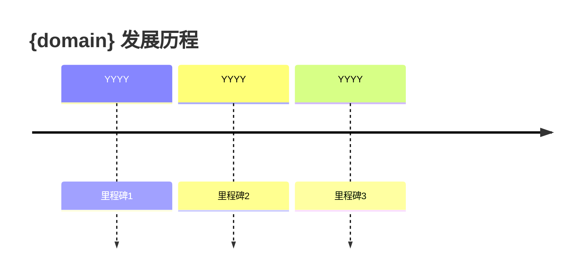

# {domain}

> [!abstract] 学习概览
> 基于 {source_count} 个来源（{source_types}），通过 NotebookLM + 苏格拉底式问答深度学习。

## 领域全景

> [!info] 核心概念
> 基于 NotebookLM 源材料提取

### 核心概念

| 概念 | 定义 |
|:-----|:-----|
| [[概念1]] | 一句话定义 |
| [[概念2]] | 一句话定义 |
| [[概念3]] | 一句话定义 |

### 主要争议

| 争议点 | 正方观点 | 反方观点 |
|:-------|:---------|:---------|
| 争议1 | ... | ... |
| 争议2 | ... | ... |

### 演进时间线

---

## 学习路径

> [!tip] 推荐学习顺序
> 按优先级和依赖关系排序

1. **子主题1** - 简述 (入门)
2. **子主题2** - 简述 (中级)
3. **子主题3** - 简述 (高级)

---

## 苏格拉底问答记录

### 子主题：{subtopic_1}

**Q**：{question}

**A**：{user_answer}

**评估**：{evaluation}

---

### 子主题：{subtopic_2}

**Q**：{question}

**A**：{user_answer}

**评估**：{evaluation}

---

## 知识差距分析

> [!warning] 待加强知识点
> 基于学习对话的差距分析

| 知识点 | 掌握程度 | 建议行动 |
|:-------|:---------|:---------|
| 概念X | 部分 | 复习源材料相关章节 |
| 概念Y | 薄弱 | 重点阅读相关论文 |

### 进一步学习方向

- **方向1**：具体描述和资源建议
- **方向2**：具体描述和资源建议

---

## 相关笔记

- [[相关笔记1]]
- [[相关笔记2]]

---

## 来源列表

| # | 来源 | 类型 |
|:-:|:-----|:-----|
| 1 | {source_1} | PDF/URL |
| 2 | {source_2} | PDF/URL |
