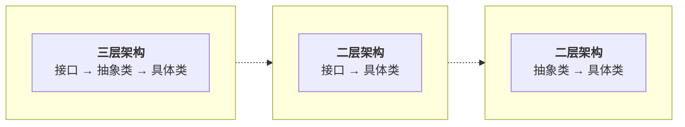

# 工厂方法模式

## 实现方式

1. 定义**产品抽象层**，声明所有产品共有的公共方法。

2. 定义**工厂抽象层**，声明工厂方法用于创建产品对象。

3. 创建**具体产品类**，遵循产品抽象层的约定。

4. 创建**具体工厂类**，遵循工厂抽象层的约定，负责创建对应的具体产品实例。

5. 客户端通过具体工厂调用工厂方法获取产品，实现创建与使用的解耦。

> **抽象层实现方式**：
> - **接口**：轻量设计，强制实现所有方法
> - **抽象类**：可复用部分逻辑，允许子类选择性实现
> - **接口+抽象类**：完整设计，接口定义契约，抽象类提供基础实现

---

### 抽象层架构选择



| 架构类型 | 层次结构 | 设计特点 | 适用场景 |
|:--------:|:--------:|:--------|:--------|
| **三层架构** | 接口 + 抽象类 + 具体类 | 契约清晰、复用性强、扩展灵活 | 大型项目、需严格规范 |
| **二层架构** | 接口 + 具体类 | 轻量简洁、强制实现、统一契约 | 简单场景、无公共逻辑 |
| **二层架构** | 抽象类 + 具体类 | 逻辑复用、灵活实现、渐进演化 | 有公共逻辑的继承体系 |

> **选择建议**：优先考虑**接口**定义契约，需要公共逻辑时引入**抽象类**，两者结合构成**三层架构**。


## 优缺点

**优点：**

- **解耦创建与使用**：避免创建者和具体产品之间的紧密耦合
- **单一职责原则**：将产品创建代码集中在单一位置，便于维护
- **开闭原则**：新增产品类型无需修改现有客户端代码
- **扩展灵活**：通过继承即可扩展新的产品族

**缺点：**

- **类的数量增加**：每个具体产品都需要对应的具体工厂类
- **代码复杂度提升**：引入新的子类和层次结构
- **简单场景过重**：对于产品种类少的场景可能过度设计

> **适用建议**：最好将工厂方法模式引入到**已有的创建者类层次结构**中，而非为每个产品新建完整的工厂体系。


## 应用场景

- **无法预知对象类型**：编写代码时无法确定需要创建哪些确切类及其依赖关系
- **框架扩展支持**：希望用户能扩展软件库或框架的内部组件，无需修改核心代码
- **对象复用优化**：复用现有对象节省系统资源，而非每次都重新创建

## 代码实现

> 以日志系统为例，演示三种架构实现。

### 实现方式一：二层架构（接口）

轻量设计，适合简单场景。

```java
// 产品接口
interface Logger {
    void log(String message);
}

// 具体产品
class FileLogger implements Logger {
    public void log(String message) {
        System.out.println("[文件] " + message);
    }
}

class ConsoleLogger implements Logger {
    public void log(String message) {
        System.out.println("[控制台] " + message);
    }
}

// 工厂接口
interface LoggerFactory {
    Logger createLogger();
}

// 具体工厂
class FileLoggerFactory implements LoggerFactory {
    public Logger createLogger() {
        return new FileLogger();
    }
}

class ConsoleLoggerFactory implements LoggerFactory {
    public Logger createLogger() {
        return new ConsoleLogger();
    }
}

// 客户端
public class Client {
    public static void main(String[] args) {
        LoggerFactory factory = new FileLoggerFactory();
        Logger logger = factory.createLogger();
        logger.log("系统启动");
    }
}
```

**特点：**

- 结构简洁，强制实现所有方法
- 适合产品种类固定、无公共逻辑的场景
- 扩展新产品需要新增接口实现类

---

### 实现方式二：二层架构（抽象类）

适合有公共逻辑的继承体系。

```java
// 产品抽象类
abstract class Logger {
    // 公共逻辑：时间戳
    protected String timestamp() {
        return java.time.LocalDateTime.now().toString();
    }

    // 抽象方法，子类必须实现
    abstract void writeLog(String message);

    // 模板方法
    public void log(String message) {
        writeLog("[" + timestamp() + "] " + message);
    }
}

// 具体产品
class FileLogger extends Logger {
    void writeLog(String message) {
        System.out.println("[文件] " + message);
    }
}

class ConsoleLogger extends Logger {
    void writeLog(String message) {
        System.out.println("[控制台] " + message);
    }
}

// 工厂抽象类
abstract class LoggerFactory {
    // 公共逻辑：验证配置
    protected boolean validateConfig() {
        return true;
    }

    abstract Logger createLogger();
}

// 具体工厂
class FileLoggerFactory extends LoggerFactory {
    Logger createLogger() {
        if (validateConfig()) {
            return new FileLogger();
        }
        throw new RuntimeException("配置无效");
    }
}

class ConsoleLoggerFactory extends LoggerFactory {
    Logger createLogger() {
        return new ConsoleLogger();
    }
}
```

**特点：**

- 复用公共逻辑（如时间戳、配置验证）
- 子类可选择性地重写方法
- 适合有公共行为的继承体系

---

### 实现方式三：三层架构（接口 + 抽象类）

完整设计，适合大型项目。

```java
// ==================== 产品层 ====================

/**
 * 产品接口：定义契约
 * 设计意图：强制所有实现类提供完整功能，定义统一规范
 */
interface Logger {
    void log(String message);           // 简单方式：默认级别
    void log(String level, String message);  // 完整方式：指定级别
}

/**
 * 产品抽象类：提供基础实现
 * 设计意图：实现接口的部分方法，提供公共逻辑，减少子类重复
 */
abstract class AbstractLogger implements Logger {
    // 公共逻辑：时间戳（子类直接复用）
    protected String timestamp() {
        return java.time.LocalDateTime.now().toString();
    }

    // 基础实现：默认 INFO 级别（子类可直接继承）
    public void log(String message) {
        log("INFO", message);
    }
    
    // 推荐：显式声明
    // 抽象方法：子类必须实现（输出逻辑因产品而异）
    public abstract void log(String level, String message);
}

/**
 * 具体产品：文件日志器
 * 设计意图：只实现差异部分，继承公共能力
 */
class FileLogger extends AbstractLogger {
    public void log(String level, String message) {
        System.out.println("[文件|" + level + "] " + timestamp() + " " + message);
        //                                          ↑ 继承自抽象类
    }
}

/** 其他具体产品（如 ConsoleLogger）结构相同，略 */

// ==================== 工厂层 ====================

/**
 * 工厂接口：定义契约
 * 设计意图：定义创建产品的规范，支持多种创建方式
 */
interface LoggerFactory {
    Logger createLogger();              // 默认配置
    Logger createLogger(String config); // 自定义配置
}

/**
 * 工厂抽象类：提供基础实现
 * 设计意图：实现接口的部分方法，提供公共逻辑
 */
abstract class AbstractLoggerFactory implements LoggerFactory {
    // 公共逻辑：配置验证（子类可复用或重写）
    protected boolean validateConfig(String config) {
        return config != null && !config.isEmpty();
    }

    // 默认实现：无参方法委托给带参方法
    public Logger createLogger() {
        return createLogger("default");
    }
    
    // 推荐：显式声明
    // 抽象方法：子类必须实现（创建逻辑因产品而异）
    public abstract Logger createLogger(String config);
}

/**
 * 具体工厂：文件日志器工厂
 * 设计意图：复用父类验证逻辑，实现具体创建
 */
class FileLoggerFactory extends AbstractLoggerFactory {
    public Logger createLogger(String config) {
        if (validateConfig(config)) {  // 复用抽象类方法
            return new FileLogger();
        }
        throw new RuntimeException("配置无效");
    }
}

/** 其他具体工厂（如 ConsoleLoggerFactory）结构相同，略 */
```

**特点：**

- 接口定义契约，抽象类提供基础实现
- 契约清晰，复用性强，扩展灵活
- 适合大型项目、需要严格规范的场景
