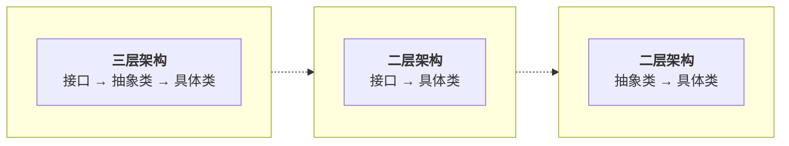

# 抽象工厂模式

> 亦称：Abstract Factory

## 意图

抽象工厂模式是一种**创建型设计模式**，能创建一系列相关的对象，无需指定其具体类。

---

## 实现方式

1. 定义**多个产品抽象层**，每个接口代表一种产品类型（如 Button、Checkbox）。

2. 定义**抽象工厂接口**，声明创建各类产品的方法（`createButton()`、`createCheckbox()`）。

3. 创建**具体产品类**，实现对应的产品接口（WindowsButton/MacButton、WindowsCheckbox/MacCheckbox）。

4. 创建**具体工厂类**，实现抽象工厂接口，负责创建**产品族**（Windows 风格全套组件 / Mac 风格全套组件）。

5. 客户端通过具体工厂获取产品族，确保所有产品风格一致。

> **与工厂方法模式的区别**：
> - **工厂方法**：创建**单一产品**，一个工厂一个方法
> - **抽象工厂**：创建**产品族**，一个工厂多个方法
>
> **抽象层实现方式**：
> - **接口**：轻量设计，强制实现所有方法
> - **抽象类**：可复用部分逻辑，允许子类选择性实现
> - **接口+抽象类**：完整设计，接口定义契约，抽象类提供基础实现

---

### 抽象层架构选择



| 架构类型 | 层次结构 | 设计特点 | 适用场景 |
|:--------:|:--------:|:--------|:--------|
| **三层架构** | 接口 + 抽象类 + 具体类 | 契约清晰、复用性强、扩展灵活 | 大型项目、需严格规范 |
| **二层架构** | 接口 + 具体类 | 轻量简洁、强制实现、统一契约 | 简单场景、无公共逻辑 |
| **二层架构** | 抽象类 + 具体类 | 逻辑复用、灵活实现、渐进演化 | 有公共逻辑的继承体系 |

> **选择建议**：优先考虑**接口**定义契约，需要公共逻辑时引入**抽象类**，两者结合构成**三层架构**。


## 优缺点

**优点：**

- **产品族一致性**：确保同一工厂生成的产品相互匹配，风格一致
- **解耦创建与使用**：避免客户端和具体产品代码的耦合
- **单一职责原则**：将产品生成代码抽取到同一位置，便于维护
- **开闭原则**：新增产品变体无需修改现有客户端代码

**缺点：**

- **类的数量爆炸**：每个产品类型 × 每个产品族 = 大量具体类
- **代码复杂度提升**：引入众多接口和类，结构复杂
- **扩展产品类型困难**：新增产品类型需要修改所有工厂接口和实现
- **简单场景过重**：对于产品族少的场景可能过度设计

> **适用建议**：当系统需要**多个产品族**，且产品族内的产品需要**一起使用**时，抽象工厂模式是最佳选择。但如果只有单一产品族，优先使用工厂方法模式。


## 应用场景

- **跨平台 UI 组件**：需要确保同一操作系统的 UI 元素风格一致（Windows/macOS/Linux）
- **多数据库支持**：不同数据库的连接、命令、事务等组件需要配套使用
- **多主题系统**：深色/浅色主题的图标、字体、颜色方案等需要保持一致
- **产品族变体多**：系统支持多个系列产品，且变体数量较多


## 代码实现

> 以跨平台 UI 组件系统为例，演示三种架构实现。产品包括 Button 和 Checkbox，支持 Windows 和 macOS 两个变体。

### 实现方式一：二层架构（接口）

轻量设计，适合简单场景。

```java
// ==================== 产品接口 ====================

interface Button {
    void paint();
}

interface Checkbox {
    void paint();
}

// ==================== Windows 产品族 ====================

class WindowsButton implements Button {
    public void paint() {
        System.out.println("You have created WindowsButton.");
    }
}

class WindowsCheckbox implements Checkbox {
    public void paint() {
        System.out.println("You have created WindowsCheckbox.");
    }
}

// ==================== Mac 产品族 ====================

class MacButton implements Button {
    public void paint() {
        System.out.println("You have created MacButton.");
    }
}

class MacCheckbox implements Checkbox {
    public void paint() {
        System.out.println("You have created MacCheckbox.");
    }
}

// ==================== 抽象工厂 ====================

interface GUIFactory {
    Button createButton();
    Checkbox createCheckbox();
}

// ==================== 具体工厂 ====================

class WindowsFactory implements GUIFactory {
    public Button createButton() {
        return new WindowsButton();
    }

    public Checkbox createCheckbox() {
        return new WindowsCheckbox();
    }
}

class MacFactory implements GUIFactory {
    public Button createButton() {
        return new MacButton();
    }

    public Checkbox createCheckbox() {
        return new MacCheckbox();
    }
}

// ==================== 客户端 ====================

class Application {
    private final Button button;
    private final Checkbox checkbox;

    public Application(GUIFactory factory) {
        this.button = factory.createButton();
        this.checkbox = factory.createCheckbox();
    }

    public void paint() {
        button.paint();
        checkbox.paint();
    }
}

// ==================== 配置类 ====================

class Demo {
    private static Application configureApplication() {
        GUIFactory factory;
        String osName = System.getProperty("os.name").toLowerCase();

        if (osName.contains("mac")) {
            factory = new MacFactory();
        } else {
            factory = new WindowsFactory();
        }

        return new Application(factory);
    }

    public static void main(String[] args) {
        Application app = configureApplication();
        app.paint();
        // Windows 系统输出：
        // You have created WindowsButton.
        // You have created WindowsCheckbox.
    }
}
```

**特点：**

- 结构简洁，强制实现所有方法
- 适合产品族固定、无公共逻辑的场景
- 扩展新产品族需要新增工厂和所有产品类

---

### 实现方式二：二层架构（抽象类）

适合有公共逻辑的继承体系。

```java
// ==================== 产品抽象类 ====================

abstract class Button {
    // 公共逻辑：默认尺寸
    protected int getWidth() {
        return 100;
    }

    protected int getHeight() {
        return 30;
    }

    abstract void paint();
}

abstract class Checkbox {
    // 公共逻辑：选中状态
    protected boolean checked = false;

    public void toggle() {
        checked = !checked;
    }

    abstract void paint();
}

// ==================== 具体产品 ====================

class WindowsButton extends Button {
    void paint() {
        System.out.println("[Windows] 渲染按钮，尺寸：" + getWidth() + "x" + getHeight());
    }
}

class WindowsCheckbox extends Checkbox {
    void paint() {
        System.out.println("[Windows] 渲染复选框，状态：" + (checked ? "选中" : "未选中"));
    }
}

class MacButton extends Button {
    void paint() {
        System.out.println("[Mac] 渲染圆角按钮，尺寸：" + getWidth() + "x" + getHeight());
    }
}

class MacCheckbox extends Checkbox {
    void paint() {
        System.out.println("[Mac] 渲染复选框，状态：" + (checked ? "选中" : "未选中"));
    }
}

// ==================== 工厂抽象类 ====================

abstract class GUIFactory {
    // 公共逻辑：验证操作系统
    protected boolean isValidOS(String os) {
        return os != null && !os.isEmpty();
    }

    abstract Button createButton();
    abstract Checkbox createCheckbox();
}

// ==================== 具体工厂 ====================

class WindowsFactory extends GUIFactory {
    Button createButton() {
        if (isValidOS("Windows")) {
            return new WindowsButton();
        }
        throw new RuntimeException("无效的操作系统");
    }

    Checkbox createCheckbox() {
        return new WindowsCheckbox();
    }
}

class MacFactory extends GUIFactory {
    Button createButton() {
        if (isValidOS("Mac")) {
            return new MacButton();
        }
        throw new RuntimeException("无效的操作系统");
    }

    Checkbox createCheckbox() {
        return new MacCheckbox();
    }
}
```

**特点：**

- 复用公共逻辑（如默认尺寸、选中状态）
- 子类可选择性地重写方法
- 适合有公共行为的继承体系

---

### 实现方式三：三层架构（接口 + 抽象类）

完整设计，适合大型项目。

```java
// ==================== 产品层 ====================

/**
 * 产品接口：定义契约
 * 设计意图：强制所有实现类提供完整功能，定义统一规范
 */
interface Button {
    void paint();
    void setTooltip(String text);
}

interface Checkbox {
    void paint();
    voidsetChecked(boolean checked);
}

/**
 * 产品抽象类：提供基础实现
 * 设计意图：实现接口的部分方法，提供公共逻辑，减少子类重复
 */
abstract class AbstractButton implements Button {
    protected String tooltip;

    // 基础实现：工具提示设置
    public void setTooltip(String text) {
        this.tooltip = text;
    }

    // 抽象方法：子类必须实现
    public abstract void paint();
}

abstract class AbstractCheckbox implements Checkbox {
    protected boolean checked = false;

    // 基础实现：选中状态切换
    public void setChecked(boolean checked) {
        this.checked = checked;
    }

    public abstract void paint();
}

/**
 * 具体产品：Windows 风格
 * 设计意图：只实现差异部分，继承公共能力
 */
class WindowsButton extends AbstractButton {
    public void paint() {
        System.out.println("[Windows] 渲染方形按钮" +
                          (tooltip != null ? " (提示: " + tooltip + ")" : ""));
    }
}

class WindowsCheckbox extends AbstractCheckbox {
    public void paint() {
        System.out.println("[Windows] 渲染复选框，状态：" + (checked ? "选中" : "未选中"));
    }
}

/**
 * 具体产品：Mac 风格
 */
class MacButton extends AbstractButton {
    public void paint() {
        System.out.println("[Mac] 渲染圆角按钮" +
                          (tooltip != null ? " (提示: " + tooltip + ")" : ""));
    }
}

class MacCheckbox extends AbstractCheckbox {
    public void paint() {
        System.out.println("[Mac] 渲染复选框，状态：" + (checked ? "选中" : "未选中"));
    }
}

// ==================== 工厂层 ====================

/**
 * 工厂接口：定义契约
 * 设计意图：定义创建产品的规范
 */
interface GUIFactory {
    Button createButton();
    Button createButton(String tooltip);
    Checkbox createCheckbox();
}

/**
 * 工厂抽象类：提供基础实现
 * 设计意图：实现接口的部分方法，提供公共逻辑
 */
abstract class AbstractGUIFactory implements GUIFactory {
    // 公共逻辑：配置验证
    protected boolean validateConfig(String config) {
        return config != null && !config.isEmpty();
    }

    // 默认实现：无参方法委托给带参方法
    public Button createButton() {
        return createButton(null);
    }

    // 抽象方法：子类必须实现
    public abstract Button createButton(String tooltip);
    public abstract Checkbox createCheckbox();
}

/**
 * 具体工厂：Windows 风格工厂
 * 设计意图：复用父类验证逻辑，实现具体创建
 */
class WindowsFactory extends AbstractGUIFactory {
    public Button createButton(String tooltip) {
        if (validateConfig("Windows")) {
            WindowsButton button = new WindowsButton();
            if (tooltip != null) {
                button.setTooltip(tooltip);
            }
            return button;
        }
        throw new RuntimeException("Windows 配置无效");
    }

    public Checkbox createCheckbox() {
        return new WindowsCheckbox();
    }
}

/**
 * 具体工厂：Mac 风格工厂
 */
class MacFactory extends AbstractGUIFactory {
    public Button createButton(String tooltip) {
        if (validateConfig("Mac")) {
            MacButton button = new MacButton();
            if (tooltip != null) {
                button.setTooltip(tooltip);
            }
            return button;
        }
        throw new RuntimeException("Mac 配置无效");
    }

    public Checkbox createCheckbox() {
        return new MacCheckbox();
    }
}

// ==================== 客户端 ====================

class Application {
    private final GUIFactory factory;
    private final Button button;
    private final Checkbox checkbox;

    public Application(GUIFactory factory) {
        this.factory = factory;
        this.button = factory.createButton("点击我");
        this.checkbox = factory.createCheckbox();
    }

    public void paint() {
        button.paint();
        checkbox.paint();
    }
}
```

**特点：**

- 接口定义契约，抽象类提供基础实现
- 契约清晰，复用性强，扩展灵活
- 适合大型项目、需要严格规范的场景


## 对比分析

| 对比项 | 工厂方法模式 | 抽象工厂模式 |
|:------|:------------|:------------|
| **创建对象** | 单一产品 | 产品族（多个相关产品） |
| **工厂方法数量** | 一个方法 | 多个方法 |
| **类层次结构** | 产品 × 工厂 = 2n | 产品 × 产品族 × 工厂 = 3n |
| **扩展产品类型** | 新增工厂类 | 修改所有工厂接口 |
| **扩展产品族** | 修改工厂类 | 新增工厂类 |
| **典型场景** | 日志器、解析器 | UI 组件、数据库访问 |

