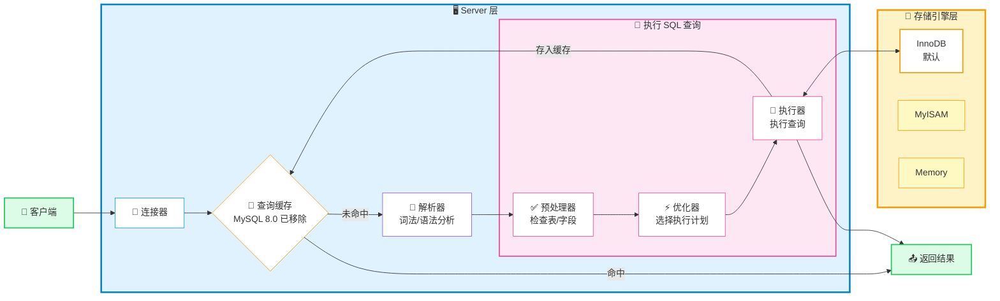
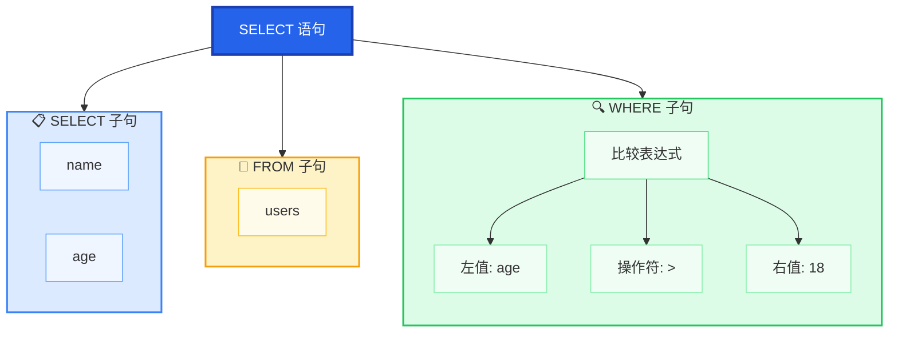

# [执行一条 select 语句，期间发生了什么？](https://xiaolincoding.com/mysql/base/how_select.html)

> 来源：小林Coding

## MySQL 架构概览

MySQL 架构分为两层：

| 层级 | 职责 | 核心模块 |
|------|------|---------|
| **Server 层** | 建立连接、分析和执行 SQL | 连接器、查询缓存、解析器、预处理器、优化器、执行器 |
| **存储引擎层** | 数据存储和提取 | InnoDB（默认）、MyISAM、Memory（[[MySQL 一行记录是怎么存储的？]]） |



## 执行流程

### 1. 连接器

**职责：**
- 与客户端进行 TCP 三次握手建立连接
- 校验客户端的用户名和密码
- 读取该用户的权限，后续权限判断基于此时读取的权限

> **注意：** 用户建立连接后，即使管理员中途修改了该用户的权限，也不会影响已存在连接的权限。只有新建的连接才会使用新的权限设置。

**关键参数：**

| 参数 | 默认值 | 说明 |
|------|--------|------|
| `wait_timeout` | 28880秒（8小时） | 空闲连接最大时长 |
| `max_connections` | 151 | 最大连接数 |

**长连接内存问题解决：**
- **定期断开长连接**：断开后释放连接占用的内存资源
- **调用 `mysql_reset_connection()`**：重置连接到刚创建完的状态，不需要重连和重新验证权限

**查看连接：**
```sql
show processlist;
```

### 2. 查询缓存

- 以 key-value 形式保存在内存中，key 为 SQL 查询语句，value 为查询结果
- **只要表有更新操作，该表的查询缓存就会被清空**
- MySQL 8.0 版本已完全移除此功能

### 3. 解析 SQL

#### 解析器

**1. 词法分析**

识别 SQL 语句中的关键字和非关键字，将输入字符串分解为 Token（标记）。

例如：`select username from userinfo`

| 关键字 | 非关键字 | 关键字 | 非关键字 |
|--------|----------|--------|----------|
| select | username | from | userinfo |

词法分析器会核验 MySQL 的关键字（如 `SELECT`、`FROM`、`WHERE`、`INSERT`、`UPDATE`、`DELETE` 等），区分保留字和用户自定义标识符。

**2. 语法分析**

根据词法分析的结果，按照 MySQL 语法规则判断 SQL 语句是否合法，如果语法正确则构建**语法树**。

**语法树示例：**

以 `SELECT name, age FROM users WHERE age > 18` 为例：



**语法树的作用：**

- **预处理器**：提取表名、字段名进行存在性检查
- **优化器**：基于树结构分析查询成本，选择最优执行计划
- **执行器**：按照树的结构逐步执行查询操作

可获取的信息：
- SQL 类型（SELECT/INSERT/UPDATE/DELETE）
- 表名
- 字段名
- WHERE 条件

> **语法错误示例：** 把 `from` 写成 `form`，会在解析器阶段报错：
> ```
> ERROR 1064 (42000): You have an error in your SQL syntax
> ```

> ❌ **重要：** 解析器**只检查语法**，**不检查**表或字段是否存在，这由预处理器负责

### 4. 执行 SQL

#### 预处理器

- 检查 SQL 查询语句中的表或者字段是否存在
- 将 `select *` 中的 `*` 符号扩展为表上的所有列

#### 优化器

**职责：** 确定 SQL 查询语句的执行方案

- 选择执行成本最小的索引
- 可用 `explain` 命令查看执行计划

```sql
-- 查看执行计划
explain select * from product where id = 1;
```

#### 执行器

根据执行计划执行 SQL 查询语句，与存储引擎交互。

**三种典型交互方式：**

| 方式 | 访问类型 | 流程 |
|------|---------|------|
| **主键索引查询** | const | 定位第一条记录 → 返回 → 结束 |
| **全表扫描** | ALL | 逐条读取 → Server层判断 → 发送客户端 |
| **索引下推** | index condition | 存储引擎先过滤再回表，减少回表次数 |

> 索引下推（ICP）是 MySQL 5.6 推出的优化策略，将 Server 层部分判断工作交给存储引擎层处理，减少回表操作。
>
> `Explain` 中 `Extra: Using index condition` 表示启用索引下推。

### 5. 索引核心机制与优化概念

#### 联合索引

**定义：** 将多个字段组合成一个索引（非聚簇索引）。

**底层机制：** B+ 树按定义时的字段顺序依次比较大小构建。先按列 1 排序，列 1 相同时按列 2 排序，依此类推。

```sql
CREATE INDEX idx_a_b_c ON table_name(a, b, c);
```

**核心要点：**

| 要点 | 说明 |
|------|------|
| **空间优势** | 建一个 `(a,b,c)` 联合索引，等同于建了 `(a)`、`(a,b)`、`(a,b,c)` 三个索引，节约空间和维护开销 |
| **使用场景** | 频繁同时作为查询条件的列，优先建立联合索引 |

#### 最左匹配原则

**定义：** 联合索引在匹配时，必须从最左边的列开始，不能跳过中间列，遇到范围查询即停止（后续列无法走 B+ 树检索）。

**匹配表现：**（以索引 `(a, b, c)` 为例）

| 查询条件 | 索引生效情况 | 补充说明 |
|---------|-------------|------|
| `a=1 AND b=2` | ✅ 用到 `a, b` | 精确匹配前两列 |
| `b=2 AND a=1` | ✅ 用到 `a, b` | **MySQL 优化器会自动调整顺序**以匹配索引 |
| `b=2 AND c=3` | ❌ 索引失效 | 跳过了首列 `a`，走全表扫描 |
| `a=1 AND c=3` | ⚠️ 用到 `a` | 跳过 `b`，`c` 无法走 B+ 树（但会触发**索引下推**）|
| `a=1 AND b>2 AND c=3` | ⚠️ 用到 `a, b` | `b` 是范围查询，`c` 停止匹配 |

**核心要点：**

| 要点 | 说明 |
|------|------|
| **范围查询界定** | 包含 `>`、`<`、`BETWEEN` 以及 **`LIKE 'xxx%'`**（前缀匹配也会截断后续列的索引）|
| **特例** | `>=`、`<=` 在部分场景下（如等值边界时）可能不会截断后续列，但通常视为范围查询 |

#### 覆盖索引

**定义：** 是一种**查询效果**，指索引的叶子节点已经包含了查询所需的所有字段，**无需回表**（查聚簇索引）拿数据。

```sql
-- 联合索引 (name, age)，且聚簇索引为 id
SELECT id, name, age FROM users WHERE name = '张三';
```

**核心要点：**

| 要点 | 说明 |
|------|------|
| **本质** | 不是物理索引类型，而是查询时的**最高效状态** |
| **识别** | `EXPLAIN` 中 `Extra` 显示 `Using index`（**不是** `Using index condition`）|
| **优化手段** | 避免使用 `SELECT *`，把需要的字段加入联合索引以触发覆盖索引 |

#### 索引下推（Index Condition Pushdown, ICP）

**定义：** MySQL 5.6 引入的优化。在联合索引遍历过程中，**直接拦截并过滤掉不符合条件的记录**，符合条件的才去回表。

```sql
-- 联合索引 (name, age)
SELECT * FROM users WHERE name LIKE '张%' AND age = 20;
```

**核心要点：**

| 要点 | 说明 |
|------|------|
| **解决痛点** | MySQL 5.6 之前，`name LIKE '张%'` 匹配后，`age=20` 无法走索引，必须把所有姓张的记录**全部回表**去 Server 层对比 age。引入 ICP 后，在**存储引擎层**直接过滤 age，**大幅减少回表次数**|
| **适用条件** | 仅适用于**二级索引（辅助索引）** |
| **识别** | `EXPLAIN` 中 `Extra` 显示 `Using index condition` |
