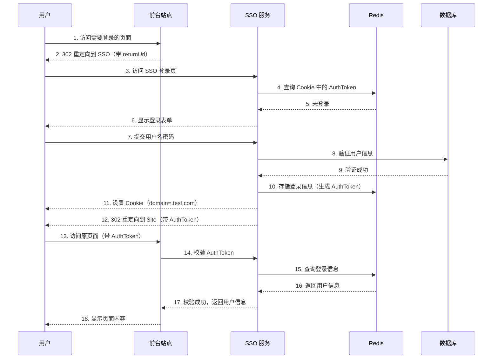
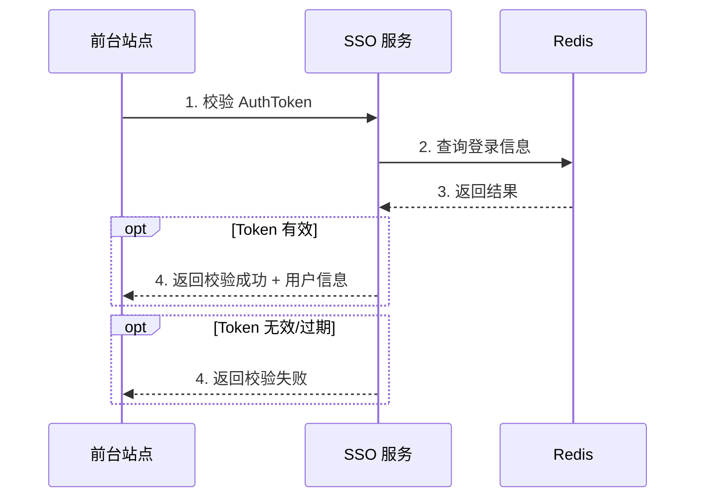
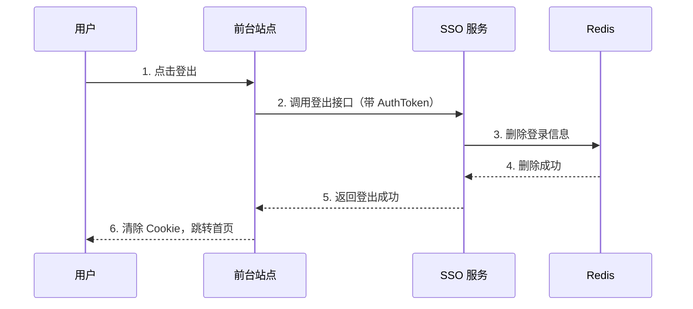
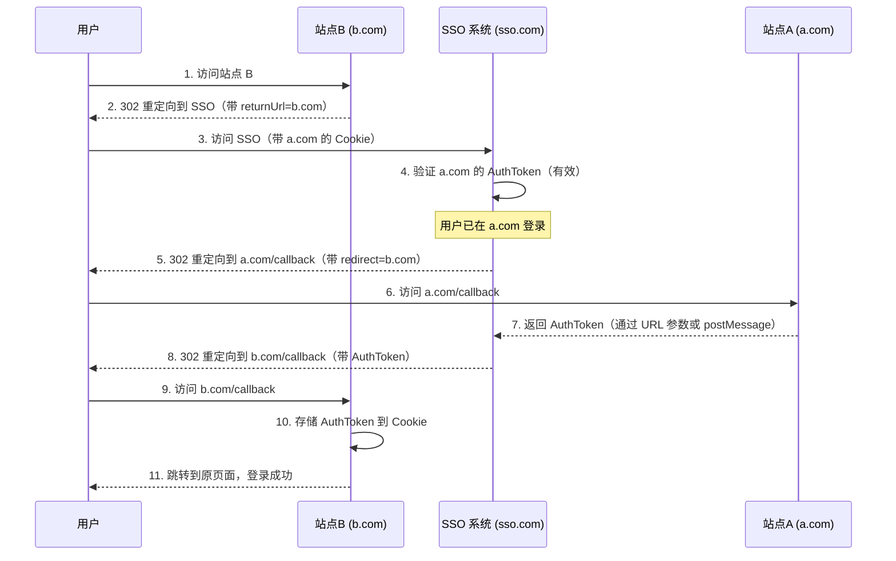
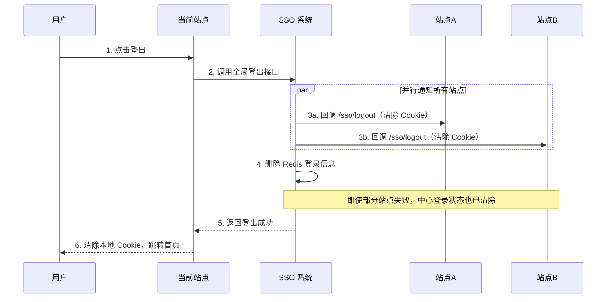

# SSO 单点登录

**SSO** = Single Sign On

## 什么是 SSO

SSO 是在多个应用系统中，用户只需要登录一次就可以访问所有相互信任的应用系统。

```
SSO = 一次登录，处处通行
```

### 好处

| 角度 | 好处 |
|------|------|
| **用户** | 一次登录多次使用，无需记录多套账号密码 |
| **管理员** | 只需维护一个统一的账号中心 |
| **新系统** | 直接对接统一账号中心，简化开发 |

## SSO 系统设计

### 核心模块

| 模块 | 说明 |
|------|------|
| **前台站点** | 需要登录的站点 |
| **SSO 站点** | 提供登录/登出页面 |
| **SSO 服务** | 提供登录/校验/登出服务 |
| **数据库** | 存储用户账户信息 |
| **缓存** | 存储用户登录信息（Redis） |

### 登录状态存储

| 对象 | 说明 |
|------|------|
| **AuthToken** | UUID/GUID，存于客户端 Cookie |
| **登录信息** | UserId、UserName，存于 Redis |

> 💡 **推荐**：使用 Redis 集群存储登录信息，支持高可用和水平扩展。

## 同域登录流程

### 登录



### 登录状态校验



### 登出



## 跨域登录流程

### 核心思路

Cookie 跨域无法直接共享，通过**回调**方式传递 AuthToken：

| 场景 | 解决方案 |
|------|----------|
| **跨域登录** | 登录完成后回调，将 AuthToken 传递给其他域，各域自行存储 |
| **跨域登出** | 登出完成后回调，调用其他域的登出接口 |

### 跨域登录（主域名已登录）

> 假设：用户已在站点 A（a.com）登录，现在访问站点 B（b.com）



### 跨域登录（主域名未登录）

流程与同域登录类似，登录完成后：
1. SSO 通过回调将 AuthToken 传递给各站点
2. 各站点收到后自行存储到本地 Cookie

### 跨域登出



## 技术要点

| 要点 | 说明 |
|------|------|
| **Cookie Domain** | 设置为主域名（如 `.test.com`）实现同域共享 |
| **AuthToken** | 使用 UUID/GUID，或加密 UserName+时间戳 |
| **存储** | Redis 集群，支持高可用和水平扩展 |
| **安全性** | APP 访问需增加签名验证 |
| **跨域方案** | 回调方式传递 Token，各域自行存储 |
| **重定向** | 使用 HTTP 302 状态码，携带回调地址 |

## SSO vs OAuth

| 对比维度 | SSO | OAuth 2.0 |
|----------|-----|-----------|
| **用途** | 同一系统多应用统一登录 | 第三方授权登录 |
| **场景** | 企业内部系统多应用 | 微信登录、Google 登录 |
| **用户体系** | 统一用户体系 | 不同系统用户体系 |
| **关系** | 可结合使用 | 可用 JWT 作为 Token |

## 参考资料

- [JavaGuide - SSO 单点登录详解](https://javaguide.cn/system-design/security/sso-intro.html)
- [ken.io - SSO 设计与实现](https://ken.io/note/sso-design-implement)
