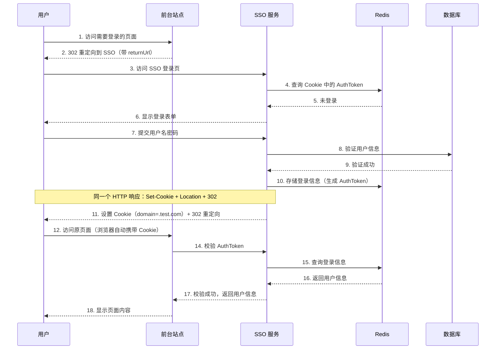
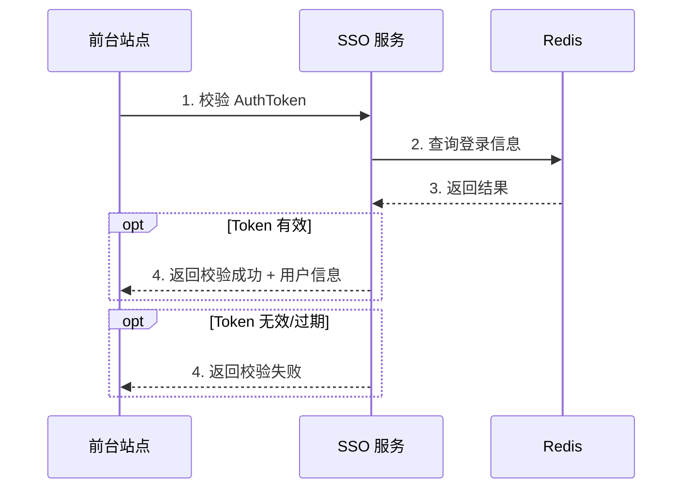
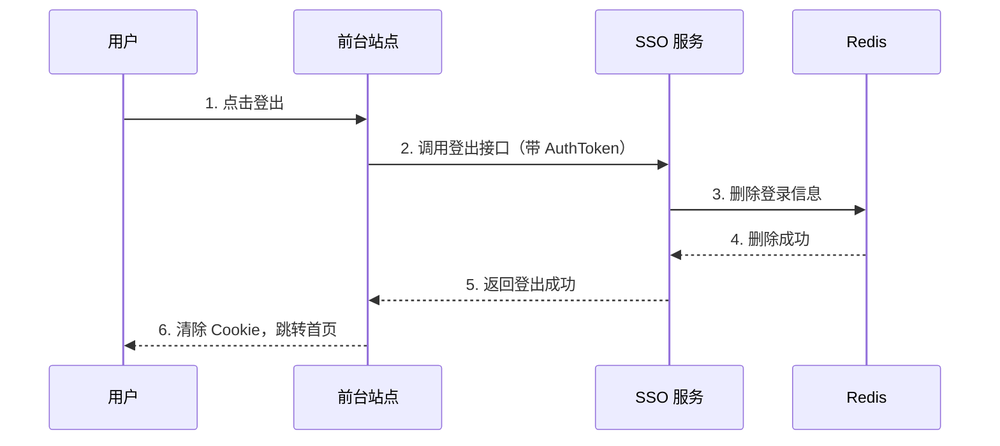
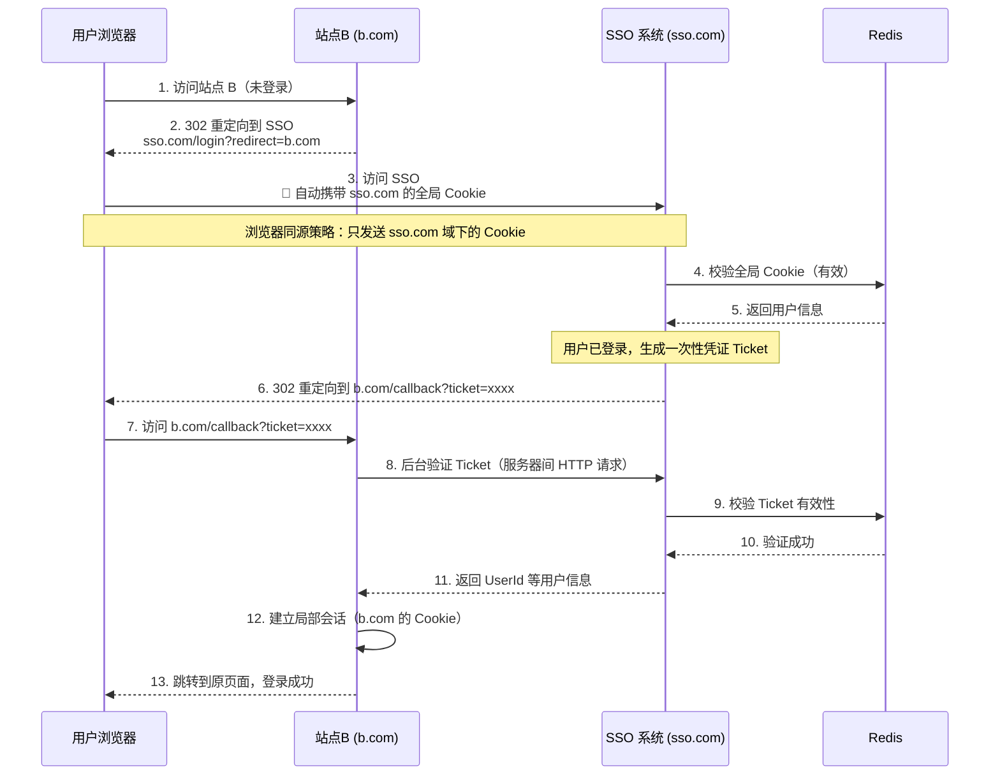
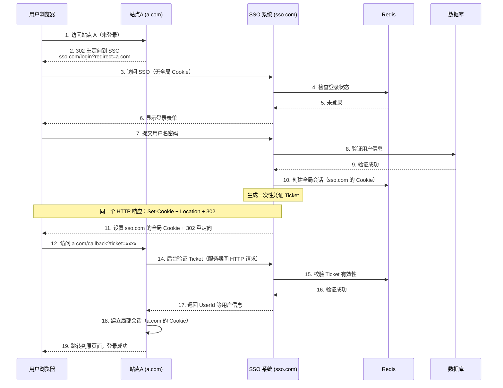
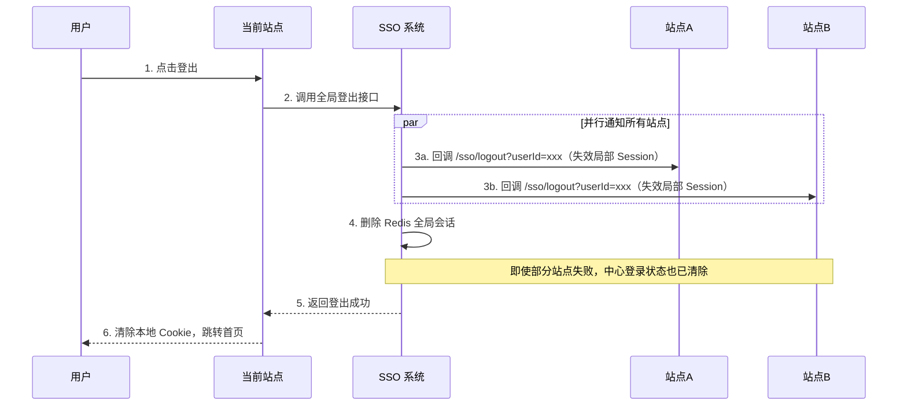

# SSO 单点登录

**SSO** = Single Sign On

## 什么是 SSO

SSO 是在多个应用系统中，用户只需要登录一次就可以访问所有相互信任的应用系统。

```
SSO = 一次登录，处处通行
```

### 好处

| 角度 | 好处 |
|------|------|
| **用户** | 一次登录多次使用，无需记录多套账号密码 |
| **管理员** | 只需维护一个统一的账号中心 |
| **新系统** | 直接对接统一账号中心，简化开发 |

## SSO 系统设计

### 核心模块

| 模块 | 说明 |
|------|------|
| **前台站点** | 需要登录的站点 |
| **SSO 站点** | 提供登录/登出页面 |
| **SSO 服务** | 提供登录/校验/登出服务 |
| **数据库** | 存储用户账户信息 |
| **缓存** | 存储用户登录信息（Redis） |

### 登录状态存储

| 对象 | 说明 |
|------|------|
| **AuthToken** | 长效会话标识，存于客户端 Cookie，对应 Redis 中的登录信息 |
| **Ticket** | 短效一次性凭证，用于跨域传递，验证后立即失效 |
| **登录信息** | UserId、UserName，存于 Redis |

> 💡 **推荐**：使用 Redis 集群存储登录信息，支持高可用和水平扩展。
>
> 📌 **AuthToken vs Ticket**：
> - AuthToken = 长期会话标识（如 7 天有效），存于 Cookie
> - Ticket = 临时传递凭证（如 30 秒有效），用于 URL 重定向，一次性使用

## 同域登录流程

### 登录



### 登录状态校验



### 登出



## 跨域登录流程

### 核心思路

Cookie 跨域无法直接共享，通过**一次性 Ticket** 实现：

| 场景 | 解决方案 |
|------|----------|
| **跨域登录** | SSO 验证全局会话后生成 Ticket，业务系统后台验证 Ticket 换取用户信息 |
| **跨域登出** | 登出完成后回调，调用其他域的登出接口 |

> 💡 **Ticket 特性**：
> - **短时效**：通常 30 秒 - 5 分钟内有效
> - **一次性**：验证后立即失效，防止重放攻击
> - **服务端验证**：通过后台 HTTP 请求验证，不经过浏览器

### 跨域登录（主域名已登录）

> 假设：用户已在站点 A（a.com）登录，现在访问站点 B（b.com）
>
> 💡 **核心概念**：跨域 SSO 存在两种会话
> - **全局会话**：存在 SSO 域名下（sso.com 的 Cookie）
> - **局部会话**：存在各应用域名下（a.com、b.com 各自的 Cookie）
>
> 用户在 a.com 登录时，实际已在 sso.com 建立全局会话。访问 b.com 时，浏览器会自动携带 sso.com 的全局 Cookie。



> ⚠️ **关键点**：
> 1. 第3步浏览器只发送 sso.com 域下的 Cookie，绝不会发送 a.com 的 Cookie（同源策略）
> 2. Ticket 是一次性凭证，验证后立即失效，防止重放攻击
> 3. 第8步是服务器间通信，不经过浏览器，避免 Token 泄露

### 跨域登录（主域名未登录）

> 假设：用户首次登录，访问站点 A（a.com）



> 💡 **与已登录场景的区别**：
> - 未登录：需要显示登录表单，验证用户名密码
> - 已登录：直接验证全局 Cookie，跳过登录表单

### 跨域登出



> ⚠️ **说明**：SSO 无法直接清除其他域的客户端 Cookie（同源策略），实际是调用各站点后端接口，使其局部 Session 失效。用户再次操作该站点时，后端校验不通过，实现登出效果。

## 技术要点

| 要点 | 说明 |
|------|------|
| **Cookie Domain** | 设置为主域名（如 `.test.com`）实现同域共享 |
| **AuthToken** | 长效会话标识，使用 UUID/GUID，或加密 UserName+时间戳 |
| **Ticket** | 短效一次性凭证，30 秒 - 5 分钟有效，验证即失效 |
| **存储** | Redis 集群，支持高可用和水平扩展 |
| **安全性** | APP 访问需增加签名验证 |
| **跨域方案** | Ticket 方式传递，各域自行建立局部会话 |
| **重定向** | 使用 HTTP 302 状态码，携带回调地址 |

> ⚠️ **安全注意**：
> - 长效 AuthToken **绝不可**通过 URL 传递（会被记录在浏览器历史、代理日志、Referer 中）
> - URL 中只能传递短效一次性 Ticket
> - Ticket 验证必须通过**服务器间 HTTP 请求**，不能在前端验证

## SSO vs OAuth

### 核心区别

| 对比维度 | SSO | OAuth 2.0 |
|----------|-----|-----------|
| **本质** | **认证**（Authentication）：你是谁 | **授权**（Authorization）：你能做什么 |
| **用途** | 同一系统多应用统一登录 | 第三方授权登录（如微信登录） |
| **场景** | 企业内部系统多应用 | 跨系统数据共享、第三方登录 |
| **用户体系** | 统一用户体系 | 可不同系统用户体系 |

### 常见协议

> 💡 **SSO 是目的，以下是实现手段**：

| 协议 | 说明 |
|------|------|
| **CAS** | 传统 SSO 协议，Central Authentication Service |
| **SAML** | 企业级 SSO 标准，XML 格式 |
| **OIDC** | 现代主流方案，基于 OAuth 2.0 的**认证**协议 |

> 📌 **OIDC = OAuth 2.0 + 身份认证层**
> - OAuth 2.0 本质是授权协议，不是认证协议
> - OIDC 在 OAuth 2.0 之上扩展了身份认证功能
> - 现代企业跨域 SSO 最主流方案是 OIDC

## 参考资料

- [JavaGuide - SSO 单点登录详解](https://javaguide.cn/system-design/security/sso-intro.html)
- [ken.io - SSO 设计与实现](https://ken.io/note/sso-design-implement)
