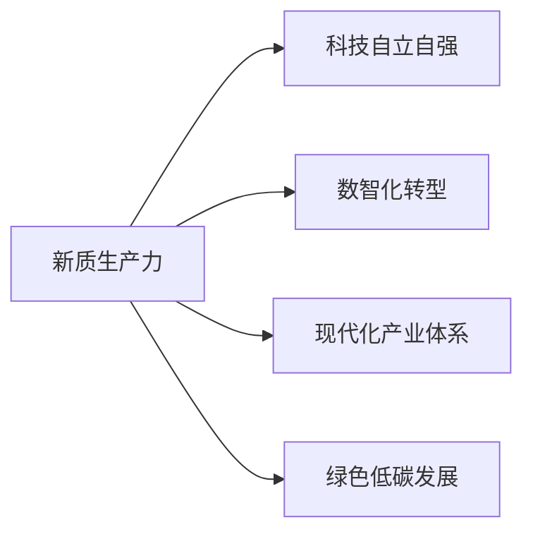
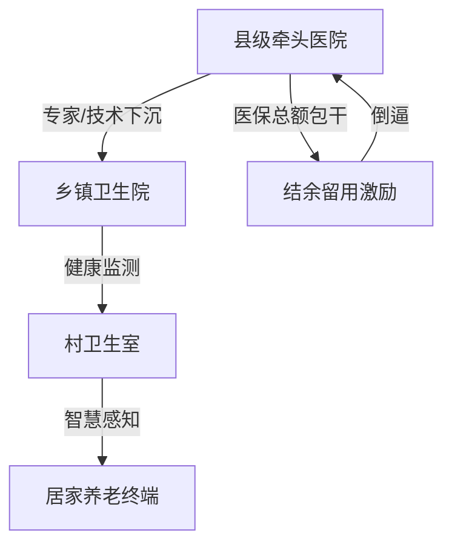
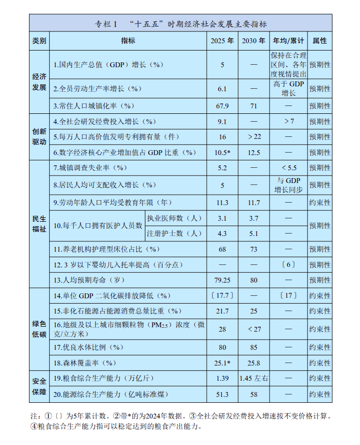

# 第一篇：奋力开创中国式现代化建设新局面

> [!abstract] 定位
> 全纲"总纲"，不涉及具体产业政策。核心价值在于**设定约束条件和优先级**，后续17篇在此框架内展开。

## 篇章结构

```
第一章 发展环境 → 十四五成就 + 十五五环境研判
第二章 指导方针 → 指导思想 + 六项原则
第三章 主要目标 → 七个维度 + 20项指标（专栏1）
```

---

## 六项重大原则

| 原则 | 核心要义 |
|:-----|:---------|
| 坚持党的全面领导 | 政治保障 |
| 坚持以人民为中心 | 发展目的 |
| 坚持高质量发展 | 主题主线 |
| 坚持深化改革开放 | 动力源泉 |
| 坚持系统观念 | 方法论 |
| 坚持底线思维 | ==安全底线== |

---

## 20项主要指标（专栏1）

> [!info] 五大领域
> 经济发展、创新驱动、民生福祉、绿色低碳、安全保障

### 经济发展

| 指标 | 2030目标 | 备注 |
|:-----|:---------|:-----|
| GDP年均增长 | 保持合理增长 | 未设具体数字 |
| 全员劳动生产率增长 | ==高于GDP增长== | 效率优先信号 |

### 创新驱动

| 指标 | 2030目标 | 备注 |
|:-----|:---------|:-----|
| 全社会研发经费年均增长 | ≥7% | 绝对增量可观 |
| 数字经济核心产业占GDP比重 | ==12.5%== | ==首次量化== |

### 民生福祉

| 指标 | 2030目标 | 备注 |
|:-----|:---------|:-----|
| 人均预期寿命 | ==80岁== | 2024年基线79岁，已有8省突破 |
| 劳动年龄人口平均受教育年限 | 11.7年 | 人力资本升级 |
| 城镇调查失业率 | ≤5.5% | 稳就业底线 |

### 绿色低碳

| 指标 | 2030目标 | 备注 |
|:-----|:---------|:-----|
| 非化石能源占能源消费比重 | ==25%== | 2022年基线~17.5%，双碳关键节点 |

### 安全保障

| 指标 | 2030目标 | 备注 |
|:-----|:---------|:-----|
| 粮食综合生产能力 | 1.45万亿斤 | 粮食安全底线 |
| 能源综合生产能力 | 58亿吨标准煤 | 能源安全底线 |

---

## 战略主线：新质生产力

> [!important] 核心抓手
> 新质生产力是实现 [[十五五-第三篇-科技自强|科技自立自强]] 和高质量发展的头号引擎。

**创新驱动 + 质态跃升（非规模扩张）**



**2025年实践进展**：人工智能核心产业规模已超1万亿元；长三角城市群在发展指数前100城市中占15席（来源：央视2025新质生产力年度盛典）

---

## 风险防范信号

> [!warning] 风险信号
> 纲要明确"以高质量发展的确定性应对各种不确定性"

| 风险领域 | 影响 |
|:---------|:-----|
| 外部不确定性 | 百年变局加速演进、保护主义抬头、地缘摩擦加剧 |
| 房地产 | 行业调整周期延续，相关投资需谨慎 |
| 地方政府债务 | 化债政策持续，地方财政空间受限 |
| 中小金融机构 | 金融监管趋严，尾部风险出清 |

> 纲要强调"识变、应变、求变"，即以**战略主动**应对外部冲击，而非被动防御。

---

## 银发经济与医疗服务下沉

> [!note] 为什么放这里
> 60岁以上人口已超3.1亿（占22%），预计2035年突破4亿。银发经济是"人均预期寿命80岁"目标的关键支撑，也是新质生产力在民生领域的重要落地场景。

### 银发经济：从"事业"到"事业+产业"

| 维度 | 传统养老 | 现代银发经济 |
|:-----|:---------|:-------------|
| 驱动 | 政府福利 | 事业+产业双轮驱动 |
| 客群 | 75岁+失能老人 | 60-69岁活力老人 + 中青年"备老"群体 |
| 需求 | 生存型 | 悦己型、高品质、数字化 |
| 市场规模 | — | 2024年8.3万亿 → 2030年预期超20万亿 |

> 2024年1月国务院印发首个"银发经济"专项政策文件，标志着养老从民生事业向产业转型的范式转移。

### 医疗服务下沉路径

**核心载体**：紧密型县域医共体（2025年底全部达标）



**关键机制**："总额包干、结余留用" — 基层预防和早诊降低住院率，牵头医院获得更多结余利润，形成下沉内生动力。

**六大共享中心**：医学检验、影像、心电、病理诊断、慢病管理、肿瘤防治 — 实现"基层检查、上级诊断"。

> [!tip] 数智化赋能医疗下沉
> 这是新质生产力在民生领域的直接落地：
> - **POCT（即时检测）**：便携化设备使心血管、糖尿病等高频检测可在村卫生室甚至家中完成
> - **AI远程审图**：基层检测结果上传云平台，上级专家远程判读，突破三甲医院围墙
> - **智慧感知终端**：毫米波雷达/红外传感器监测居家老人，异常联动急救系统

### 居家养老"9073"格局的硬缺口

90%居家、7%社区、3%机构 — 家庭是医疗服务的真正终端。

- **适老化改造**：近3成老年人已改造住房，核心诉求为防滑和洗浴；恒温花洒、跌倒感知系统正成新刚需
- **智慧监测**：毫米波雷达/红外传感器替代摄像头，兼顾隐私与安全，异常联动急救系统
- **"1+N"模式**：适老化改造 + 智慧平台 + 专业护理

### 长期护理保险（"第六险"）

> [!tip] 制度时间表
> - 2024年：49个试点城市，覆盖约3亿人，惠及330万失能群众
> - 2026年3月：中办国办发文，推进全国推行
> - **2028年底：全国基本全覆盖**，费率控制在0.3%左右

长护险的全面推行将直接激活护理服务市场，推动医护服务向基层沉淀。

### 主要挑战

| 挑战 | 现状 |
|:-----|:-----|
| 人才短缺 | 护理人员"年龄大、学历低、专业弱"，40-50岁为主 |
| 支付门槛 | 高端适老产品定价超出普通家庭承受力 |
| 数字鸿沟 | 医院自助系统成为老年人就医壁垒 |
| 标准缺失 | 产品安全、服务流程标准体系不完善 |

### 隐形考题：控费与质量的平衡

> [!question] 以日为鉴
> 日本DPC制度（按病种打包付费）的经验表明：医保控费效率至上可能导致**医疗质量打折扣**（术后并发症上升、冗余资源不足）。医共体"总额包干、结余留用"机制同样面临这一张力——如何防止基层为追求结余而"少治"或"转推"，是未来五年需要持续关注的监管难点。

---

## 20个经济社会发展指标



